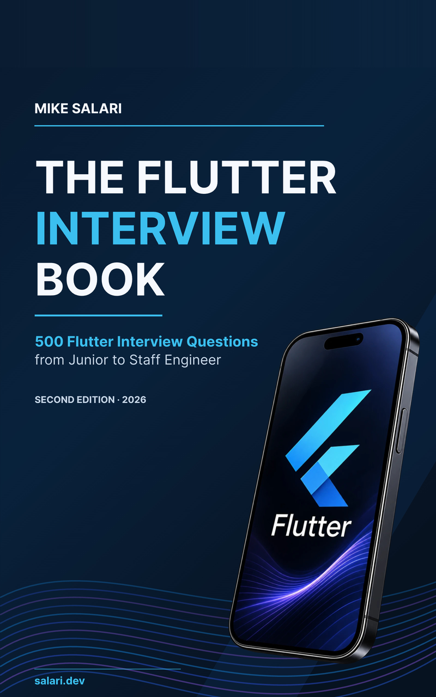

# The answer after the answer

**What Flutter interviewers ask next, from Junior to Staff.**

Free field guide from *The Flutter Interview Book* by **Mike Salari** · [salari.dev](https://salari.dev)

[**Read on desktop**](The-Answer-After-The-Answer-desktop.pdf) · [**Read on your phone**](The-Answer-After-The-Answer-mobile.pdf) · [**Get the full book**](https://salari.dev/books/the-flutter-interview-book?utm_source=github&utm_medium=readme&utm_campaign=flutter_interview_book)

---

## The first answer is the easy part

An interviewer might open with *What's the difference between a StatelessWidget and a StatefulWidget?* The follow-ups come next: who owns the state, what survives a rebuild, what triggers layout or painting, and how you would find unnecessary rendering work in a production app.

The first answer gets you a follow-up, and the follow-up is where people lose the round.

This guide climbs the four levels of a Flutter interview: state at Junior, state across modules at Mid-Level, the rendering pipeline at Senior and app architecture at Staff Engineer.

## What's inside

- **What each level has to show.** The Junior, Mid-Level, Senior and Staff expectations the book is built on.
- **The answer shape.** Clarify, answer directly, explain the mechanics, trade off, verify.
- **Level 1, Junior.** What `setState()` is for. Follow-up: how many builds do three calls in one handler cause?
- **Level 2, Mid-Level.** State management in a multi-module project. Follow-up: two features need the same signed-in user.
- **Level 3, Senior.** The Flutter rendering pipeline, with the diagram of one frame. Follow-up: the animation drops frames, but `build()` is fast.
- **Level 4, Staff Engineer.** Designing a multi-module app for a large team. The first paragraph of the answer, and what the rest of it covers.

The guide shows 4 of the book's 500 questions. The answers are taken unchanged from the book, with the book's question numbers. The follow-ups and the notes on strong answers are written for this guide.

## Pick your screen

| Edition | Best for | Pages | Open |
| --- | --- | ---: | --- |
| **Desktop** | Laptop, large screen, print | 11 | [Desktop PDF](The-Answer-After-The-Answer-desktop.pdf) |
| **Mobile** | Reading on a phone, no zooming | 13 | [Mobile PDF](The-Answer-After-The-Answer-mobile.pdf) |

Same content, two layouts. Free, no email, no sign-up.

## A reader's review of this book

> ★★★★★ I've been doing Flutter for 2 years, and this is hands down the best Flutter book I've found on the market. Recommend.
>
> Marko, review of *The Flutter Interview Book* on Gumroad

## The full book

- **Know what each level expects.** 500 questions with answers: 125 Junior, 175 Mid-Level, 125 Senior and 75 Staff Engineer.
- **Go past the first answer.** Answers explain the mechanism and, where it matters, the trade-off. Nearly every answer ends with further reading, most of it from the official Flutter and Dart documentation.
- **Prepare for senior and staff rounds.** 40 Staff Interview Labs, practical interview rounds, decision frameworks, a performance checklist and a short chapter for the night before your interview.

Every code example was analyzed with Flutter 3.47.7 and Dart 3.13.5. PDF and EPUB.

**[Get the full book](https://salari.dev/books/the-flutter-interview-book?utm_source=github&utm_medium=readme&utm_campaign=flutter_interview_book)**

## Who it's for

Flutter engineers preparing for interviews, from their first technical interview to Staff Engineer loops, and interviewers who want a structured question bank.

## About the author

**Mike Salari** is a Staff Mobile Engineer and mobile architect with 15+ years of experience building software at Apple, Adobe, Cisco, Visa, Mastercard and Deloitte, and at startups. He has run 500+ technical interviews from the hiring side.

[Website](https://salari.dev) · [LinkedIn](https://www.linkedin.com/in/mike-salari/)

## Sharing and copyright

© 2026 Mike Salari. All rights reserved.

Share the link to this repository freely. The PDFs are free to read for personal use. They are not licensed for redistribution, adaptation or commercial use. For anything beyond reading, ask the author first.

Flutter and the Flutter logo are trademarks of Google LLC. This independent publication is not affiliated with or endorsed by Google LLC.
